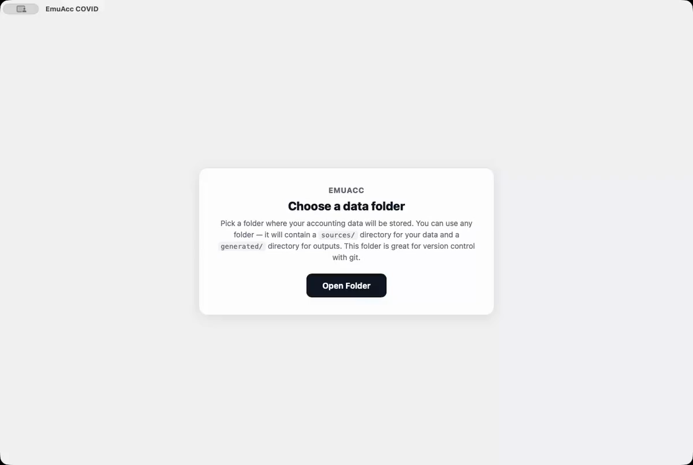

# EmuAcc - **Understand your finances.**

## Why another accounting system?

That's a good question and initially I didn't set out to build one. After trying out a number of different accounting systems and ending up running three pieces of software to cover my needs, I thought it might be easier just to build one that is more configurable and flexible for my situation. I built this for myself and hope it will be useful for others. You can read more about the philosophy of putting the user first [here](#principles), or just [get started here](#getting-started).

## Getting Started

Download the latest release from the [Releases](../../releases) tab and follow the [install steps](USER_GUIDE.md#install) for macOS, Windows or Linux. What changed in each release is in [CHANGELOG.md](CHANGELOG.md).

One continuous take of the three main flows, re-recorded for every release: choose a data folder, add an account, import a CSV, add a transaction, see the ledger file.

<a href="docs/demos/getting-started.mp4"></a>

[Watch the getting-started video](docs/demos/getting-started.mp4) (MP4, or [WebM](docs/demos/getting-started.webm)).

## Principles

Having your cake and eating it too. All the architectural decisions around this app were made to put you, the user, first, despite the additional development burden.

  - *open source* (you can read, change and run every line of it)
  - *plain text* (easy to read for humans and computers - your data portability over the needs of our app)
  - *local first*  (you can host it privately on your own desktop)
  - *AI native* (hooks for integrations with AI to do the work OR modify the software, it can help with as little or as much of your accounts as you like)

The north star is a complete, trustworthy picture of your finances, held in
files you own, that any tool you choose — this app, a shell script, a
spreadsheet, an AI agent — can read, check and extend. Instead of asking you
to trust the business, you get full control and visibility, inverting the way
most existing accounting software treats you and your data.

**Open source.** Every line is public on [GitHub](https://github.com/emuacc/emuaccounts), so you can check what it does with your data and change it to suit you.

**Files over app.** A vault is one plain text accounting folder generated from your `sources/`. This is maximally exportable. Other apps can work on top of your existing data. See [File Over App](https://stephango.com/file-over-app).

**Local-first.** Everything runs on your machine. There is no account to create and no server to depend on. Nothing leaves your machine unless you want it to. See
[Local-first software](https://www.inkandswitch.com/essay/local-first/).

**The ledger is compiled, not edited.** EmuAcc treats your finances the way an IDE treats code. `sources/` is the source code; if your source files change, the generated ledger changes. Amazing for going back to recategorise or fix things. This creates one source of truth and makes things like reports deterministic and diffable — see [Architecture](ARCHITECTURE.md).

**The format is a specification.** The ledger is a double-entry journal in the
ledger/hledger family, and its grammar is written down in
[`Ledger.g4`](./Ledger.g4), so "valid ledger" means the same thing to you, to
the app and to anything else that reads it ([format](ARCHITECTURE.md#format)).

```
2025-01-15 * "CommSec" "Buy 100 BHP @ 40.00 AUD" ; txn:buy-bhp
    assets:broker 100 BHP @@ 4000.00 AUD
    assets:broker:cash -4019.95 AUD
    expenses:fees:brokerage 19.95 AUD
```

**The UI is a thin client over the CLI.** The app calls the same Rust library
as the `emuacc-*` command-line tools, so everything it does can be scripted,
tested and automated without a window open.

**Extend at the edges, not in the core.** External data arrives through
[plugins](PLUGINS.md), a bank's export layout is handled by a per-account
transform script, categorisation by a rules file — all text you can read, copy
and version.

## A base to build on

The properties that keep you in control also make EmuAcc a base for scripts
and AI agents:

- **Text with a formal grammar** — an agent can write a ledger and know it is
  valid before the app sees it.
- **Scriptable interfaces** — `emuacc-query account:assets:bank payee:Rent
  date:2025-01` is the query the search box runs, and every report is JSON
  next to the ledger.
- **Changes are judged by their diff** — regeneration is deterministic, so the
  effect of any edit, human or machine, is exactly its diff in `generated/`.
- **A specification that executes** — the [feature files](./src-tauri/features/)
  describe the pipeline, parser, reports and CLIs in plain language and run as
  the test suite.
- **AI on the same terms as everything else** — the AI assistant turns PDF
  statements into rows, suggests categories and drafts transforms; you preview
  the result, and once accepted it is ordinary data in `sources/`. Any
  OpenAI-compatible endpoint works, local or remote.

## Status

This is the 0.1 line, the first public release. It is used daily by its author
on real data, and the pipeline, parser and reports are covered by the scenario
suite, but the UI is still growing and file formats may still change before
1.0. Expect rough edges, and please report them.

## Learn more

- [User guide](USER_GUIDE.md) — install options, what the app does and how to use it, the AI assistant, multi-device sync and the command-line tools.
- [Plugins](PLUGINS.md) — the plugins that ship with EmuAcc and how to write your own.
- [Architecture](ARCHITECTURE.md) — the pipeline, the generated output and the ledger format.
- [Development](DEVELOPMENT.md) — running from source, tests and debugging.
