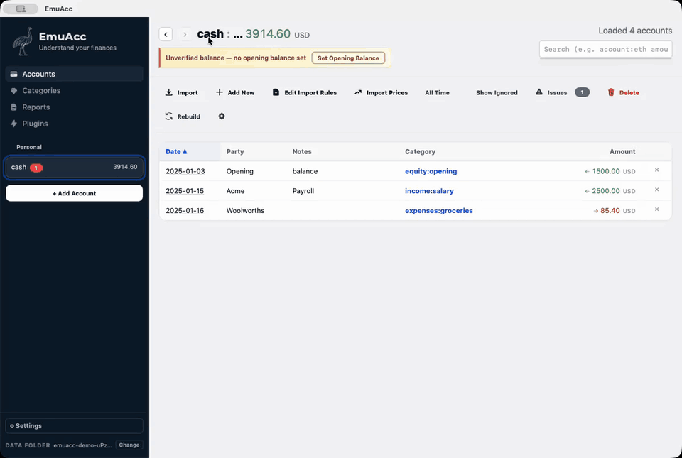
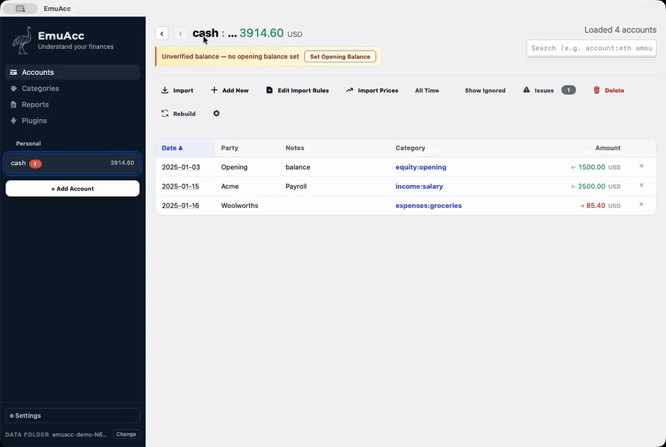

# User guide

Installing EmuAcc, using the app, and the command-line tools that do the same
work without it. The overview is in the [README](README.md).

## Install

Download the latest release from the [Releases](../../releases) tab. What
changed in each release is in [CHANGELOG.md](CHANGELOG.md).

### macOS

1. Download the `.dmg` file
2. Open the disk image and drag **EmuAcc** to Applications
3. On first launch, macOS may block the app. Go to **System Settings > Privacy & Security** and click **Open Anyway**

Alternatively, download the `.app.zip`, unzip it, and move the `.app` to Applications.

### Windows

Download **either** installer:

- `.msi` — standard Windows Installer (add/remove programs support)
- `.exe` — NSIS installer

Run the installer and follow the prompts.

### Linux (Debian / Ubuntu)

```sh
sudo dpkg -i EmuAcc_*_amd64.deb
```

### Linux (Arch)

Use the `.AppImage` (below), or convert the `.deb` with [`debtap`](https://aur.archlinux.org/packages/debtap):

```sh
debtap EmuAcc_*_amd64.deb
# debtap writes a .pkg.tar.zst next to the .deb; install that:
sudo pacman -U ./*.pkg.tar.zst
```

### Linux (other)

The `.AppImage` runs on any distribution with FUSE support:

```sh
chmod +x EmuAcc_*_amd64.AppImage
./EmuAcc_*_amd64.AppImage
```

## Using the app

- **Every account in one ledger** — bank, broker, exchange and wallet exports (CSV, OFX, or a PDF statement read by the AI assistant) compiled into one double-entry ledger.
- **Reports for tax time** — capital gains with FIFO lot matching and discount rules, income, balances, performance and a loss-harvesting view, every figure traceable to the lines that produced it. The defaults are Australian; the tax year and the CGT discount are configurable.
- **Data that keeps itself current** — [plugins](PLUGINS.md) fetch daily prices, and a transaction source for a wallet, exchange, broker or bank is a short script against the same contract.
- **A read-only [phone view](docs/PWA.md)** of the ledger, served from your own machine.
- **A command line for everything the app does** — see [Command line](#command-line).

### The main window

- Click `Import` to bring a CSV or OFX file into the selected account (EmuAcc suggests a column mapping). Other documents — PDF or text bank/dividend statements — are interpreted by the AI into a normalised CSV behind a preview‑and‑confirm step; the original is kept in the account folder's `originals/`. The same path runs headlessly as [`emuacc-ai-import`](#importing-a-pdf-or-text-statement).
- The left sidebar lists accounts and their running balances (per commodity, preferring `USD` for display).
- The main table shows transactions affecting the selected account, with `Payment` / `Deposit` split from the selected account’s posting amount.
- The **Plugins** view runs the [plugins](PLUGINS.md) that fetch prices and sync transactions.
- On your phone, the read-only web client serves the same reports: [docs/PWA.md](docs/PWA.md).

### Import a CSV



The same recording as a full-resolution video: [MP4](docs/demos/import-csv.mp4) or [WebM](docs/demos/import-csv.webm).

### Add a manual transaction



The same recording as a full-resolution video: [MP4](docs/demos/manual-txn.mp4) or [WebM](docs/demos/manual-txn.webm).

### Terminology

Some nouns in the UI are configurable. **Global Settings → Terminology** lists every term from
`src-tauri/terminology.json` with its description and default wording; type a replacement
singular/plural or leave the fields blank to keep the default. The default for one holding is
*asset* / *assets* (a coin, a share, a currency, a property…), used by the Balances and Tax
Savings reports. Overrides are saved under `terms` in the app `config.json`.

### AI assistant

AI features (document import, transform generation, categorisation suggestions) talk to any
OpenAI‑compatible endpoint configured in **Global Settings → AI assistant** (API URL, key, model,
reasoning effort, your name). For LM Studio use `http://localhost:1234/v1` with a blank key.

> **Known issue — reasoning effort with Qwen on LM Studio (as of Aug 2026):** the app sends
> `reasoning_effort` with every request and LM Studio validates it, but for Qwen 3.8 builds that
> lack "custom reasoning fields" metadata (e.g. `lmstudio-community/Qwen3.8-27B-MLX-8bit`) LM Studio
> cannot bridge the value to the model — it logs
> `No valid custom reasoning fields found … cannot be converted to any custom KVs` and the model's
> own chat template default applies instead (**upstream default: `xhigh`**, i.e. maximum thinking —
> very slow). `chat_template_kwargs` and URL parameters are also dropped before the Jinja render,
> and the 3.8 template has no `/think`/`/no_think` tag handling. **Workaround:** edit the model's
> `chat_template.jinja` (LM Studio: My Models → model → Prompt tab, or the file under
> `~/.lmstudio/models/<publisher>/<model>/`) and change
> `reasoning_effort|default('xhigh')` to `default('medium')` (or `'low'`), then reload the model.
> Re‑downloading the model overwrites the edit. The in‑app setting should start working
> per‑request once LM Studio bridges the parameter — retest after LM Studio updates by watching
> for that WARN line to disappear.

## Data files

### Data file locations

All app data lives under the platform app-data directory:

| Platform | Path |
|----------|------|
| macOS    | `~/Library/Application Support/com.emusoftware.emuaccounts/sources/` |
| Linux    | `~/.local/share/com.emusoftware.emuaccounts/sources/` |
| Windows  | `%APPDATA%\com.emusoftware.emuaccounts\sources\` |

### Files the app keeps in sources/

Besides your source files the app keeps one file of its own at the top of
`sources/`: `_trade_links.json`, which holds your trade links. It is plain
JSON, one entry per link sorted by id, so a new or removed link shows as a
small diff. It is not pipeline input — changing it neither triggers a rebuild
nor defeats the pipeline's early exit — but it is the only record of the
links, so do not delete it, and keep it under version control if the vault is
a git repository.

Earlier versions kept the links in `emuacc-metadata.automerge`. The first time
this version reads the links of a vault without `_trade_links.json`, it copies
them from that file into `_trade_links.json` and leaves
`emuacc-metadata.automerge` as it was.

## Command line

The app is a thin client over the same library as the `emuacc-*` command-line
tools, so each of these does what the app does, without a window open:
`emuacc-regenerate` builds the ledger the app builds, `emuacc-query` answers
the searches the app's search box answers, `emuacc-reports` produces the
reports the app shows, and `emuacc-web` serves the read-only [phone client](docs/PWA.md).

### Keeping data fresh from cron

`emuacc-update` refreshes the configured vault without launching the app: it
runs every daily-flagged plugin (the same batch as "update prices on
startup"), then rebuilds the generated ledger and reports. It is
non-interactive and cron-safe — exit 0 on success, non-zero when any plugin
or the rebuild fails, per-plugin outcomes on stdout, failures on stderr. The
once-per-day guard is shared with the app, so a second run on the same day
(or an app launch after a cron run) skips the fetch and still exits 0.

The vault resolves like the other CLIs: `EMUACC_SOURCES_DIR` /
`EMUACC_GENERATED_DIR` env overrides win, otherwise the app config's
`current_root`. `--force` re-runs plugins that already succeeded today;
`--sources-dir` / `--generated-dir` override the directories explicitly.

Build it once with `cargo build --release --bin emuacc-update` (from
`src-tauri/`), then schedule it.

Example crontab entry (weekdays at 07:30, log to a file):

```cron
30 7 * * 1-5 $HOME/.local/bin/emuacc-update >> $HOME/Library/Logs/emuacc-update.log 2>&1
```

Example launchd agent (macOS) — save as
`~/Library/LaunchAgents/com.emusoftware.emuaccounts.update.plist` and load with
`launchctl load ~/Library/LaunchAgents/com.emusoftware.emuaccounts.update.plist`:

```xml
<?xml version="1.0" encoding="UTF-8"?>
<!DOCTYPE plist PUBLIC "-//Apple//DTD PLIST 1.0//EN"
  "http://www.apple.com/DTDs/PropertyList-1.0.dtd">
<plist version="1.0">
<dict>
  <key>Label</key><string>com.emusoftware.emuaccounts.update</string>
  <key>ProgramArguments</key>
  <array><string>/Users/you/.local/bin/emuacc-update</string></array>
  <key>StartCalendarInterval</key>
  <dict><key>Hour</key><integer>7</integer><key>Minute</key><integer>30</integer></dict>
  <key>StandardOutPath</key><string>/Users/you/Library/Logs/emuacc-update.log</string>
  <key>StandardErrorPath</key><string>/Users/you/Library/Logs/emuacc-update.log</string>
</dict>
</plist>
```

### Importing a PDF or text statement

`emuacc-ai-import` is the Import button's AI path without the app: it extracts
the document's text, has the model configured in Global Settings turn it into a
normalised CSV, re-validates every row in Rust (dates, amounts, the
running-balance chain and the folder's transform), and prints that CSV on
stdout. Nothing is written unless `--confirm` is passed; then the CSV is staged
through `imports/` into the account folder, the original is filed under
`originals/`, and the ledger and reports are rebuilt. `--confirm` needs a
transform already in place for the folder, so bring a new folder's first
document in through the app, which writes it.

```sh
emuacc-ai-import --account alex/bank/cdia ~/Downloads/Statement.pdf             # preview only
emuacc-ai-import --account alex/bank/cdia ~/Downloads/Statement.pdf --confirm   # import
```

The vault resolves like the other CLIs (`EMUACC_SOURCES_DIR` /
`EMUACC_GENERATED_DIR`, else the app config's `current_root`), and
`EMUACC_APP_DATA_DIR` points it at a different app config. `--currency`
overrides the vault base currency assumed in the prompt. Progress and warnings
go to stderr, so `> preview.csv` captures just the rows. Exit codes: 0 on
success, 1 when extraction, validation or the import fails, 2 for usage errors.
